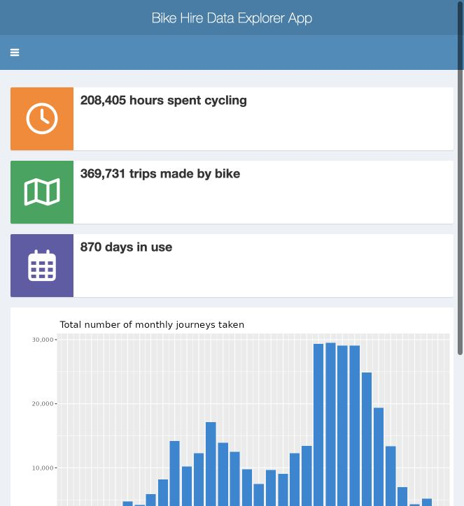
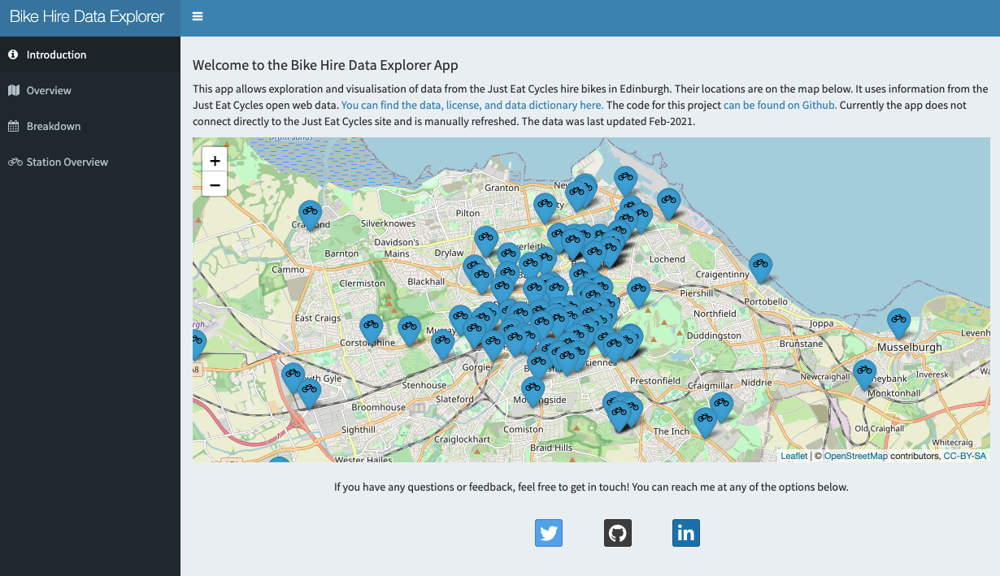
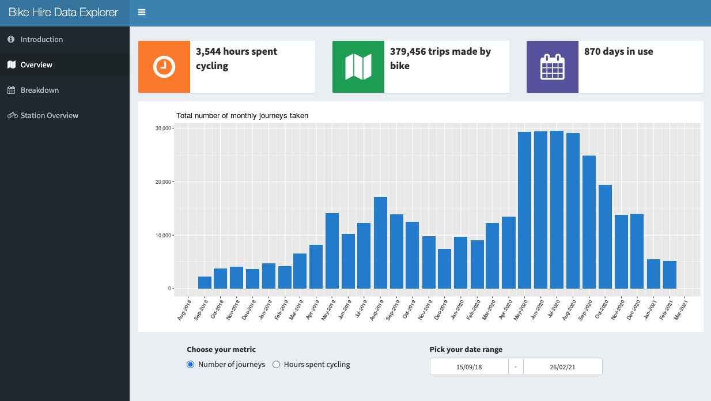
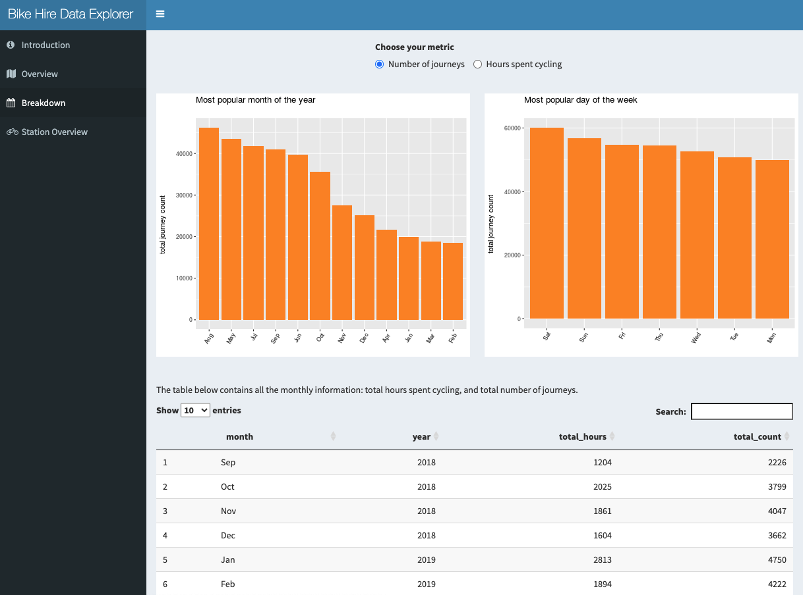
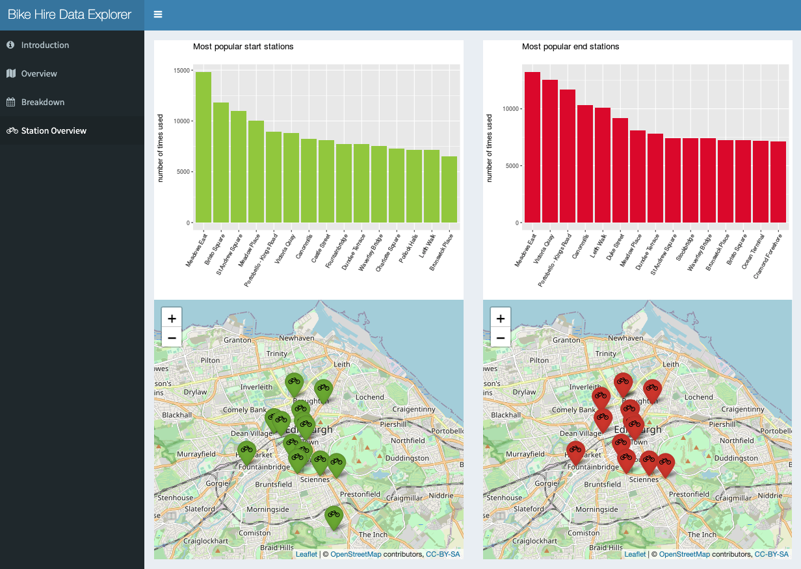
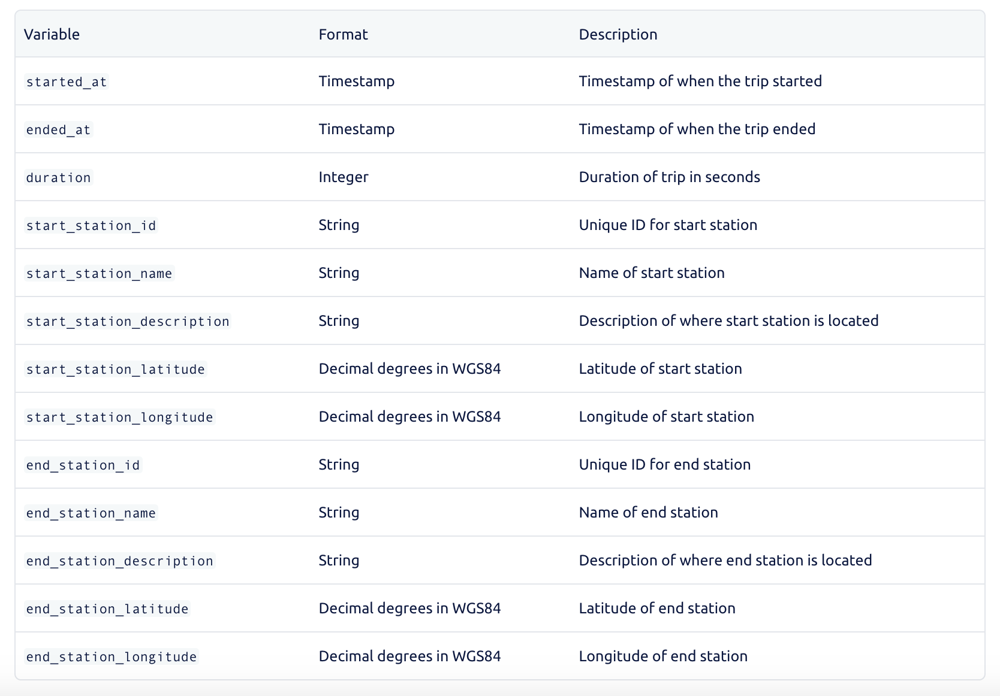

# Edinburgh Bike Hire Data Explorer

An R Shiny dashboard for exploring historical Just Eat Cycles journeys in Edinburgh.

**[Explore the live app →](https://01a17ed9-b528-1005-8629-8f2a5fc4c55c.share.connect.posit.cloud/)** · [Run it locally](#run-locally) · [How the data is prepared](#data-preparation)



Explore **369,731 journeys across 171 stations**, covering September 2018 to February 2021. Choose a date range, compare journeys with hours spent cycling, and see which stations people used.

| Explore | What you'll find |
|---|---|
| Overview | Journeys and cycling hours for a selected date range. |
| Breakdown | Patterns by month and weekday, plus a data table. |
| Stations | Popular start/end stations and their locations on a map. |

The screenshot above shows the updated deployment. The original screenshots further down are kept as a record of the first version.

## Project status

This is a historical data project. The original project recorded its last data refresh as February 2021; this maintenance pass fixes the preparation code, not the data's recency. It does not fetch live journeys.

[Open the repaired app](https://01a17ed9-b528-1005-8629-8f2a5fc4c55c.share.connect.posit.cloud/), hosted on the free Posit Connect Cloud plan. The original shinyapps.io deployment is a separate, older version. Repository changes do not automatically redeploy the app.

## Run locally

Install R, then clone this repository and open a terminal at its root (the folder containing `global.R`).

Install the packages used by the app:

```r
install.packages(c(
  "tidyverse", "lubridate", "leaflet", "shiny",
  "shinydashboard", "shinydashboardPlus", "scales", "DT"
))
```

Prepare the bundled historical CSV files before starting the app. The generated journey file is not included in the repository:

```sh
Rscript scripts/data_cleaning.R
```

Then, in R from the same directory:

```r
shiny::runApp(".")
```

Map tiles need an internet connection. The repaired app was tested with R 4.4.1; `renv.lock` records the tested package versions. To use that environment instead of installing the latest packages, run the following in R from the repository root, then prepare data and launch the app in that same R session:

```r
install.packages("renv")
renv::restore()
renv::load()
source("scripts/data_cleaning.R")
shiny::runApp(".")
```

## Publishing updates

The app uses `app.R` as its entry point on Posit Connect Cloud. To publish from R, install `rsconnect` and authorize your free Connect Cloud account with `rsconnect::connectCloudUser()`. Prepare the data first, then deploy with `appPrimaryDoc = "app.R"`, `appMode = "shiny"`, and an explicit `appFiles` list that includes `clean_data/clean_data.csv` (which is intentionally excluded from Git). Include the runtime files `app.R`, `global.R`, `ui.R`, `server.R`, `renv.lock`, `clean_data/stations.csv`, and the station, map and breakdown scripts.

Use the existing content ID `01a17ed9-b528-1005-8629-8f2a5fc4c55c` when updating this deployment. Uploading creates or updates the public app; committing to GitHub alone does not. Keep deployment credentials outside the repository.

## Data preparation

- Reads CSV files from `raw_data/` and removes identical journey rows across overlapping downloads.
- Checks required columns, timestamps and non-negative durations.
- Converts duration from seconds to minutes and hours.
- Keeps station names paired with their own coordinates. Where a station name has several locations, uses its first valid observed location.
- Writes `clean_data/clean_data.csv` and `clean_data/stations.csv`.

The historical downloads include identical files under different names. Removing identical rows prevents counting those journeys twice, although without a journey identifier truly distinct rides with identical fields cannot be distinguished.

Run the synthetic regression checks with:

```sh
Rscript tests/data_cleaning.R
```

The checks cover hour conversion, overlapping downloads, station coordinates, invalid durations and missing CSV files. They require `tidyverse` and `lubridate`.

After preparing the historical data, check the server outputs and date filtering with:

```sh
Rscript tests/server.R
```

If using the lockfile environment, run `source("tests/data_cleaning.R")` and `source("tests/server.R")` in the R session after `renv::load()` instead.

The bundled files produce 369,731 distinct journey rows, 171 stations and approximately 208,405 hours of cycling, covering 15 September 2018 to 26 February 2021. The server checks exercise journey and hours plots, station maps, total-hours consistency, a single-day selection and an empty date range. Browser checks also confirmed the introduction, overview charts and station charts/maps render with current package APIs.

## Explore the app

The Overview tab filters journeys by date. Breakdown and Station Overview summarise the whole prepared dataset.

## What's in the App?

The screenshots below are from the original 2021 version; their totals and map locations predate the data fixes.

The app contains four tabs: `introduction`, `overview`, `breakdown` and `stations`.


### Intro Tab



This contains an overview of the app, and shows all stations included in the data.

### Overview Tab



Here, you can choose the date range you wish to view, and can toggle between number of journeys/hours spent cycling.

### Breakdown Tab



On this tab, you can view the data by month or weekday. You can again choose between number of journeys taken and hours spent cycling. You also have the option to view a table of all data in the app.

### Stations Tab



On this final tab, you can see the top start and end stations, as well as their locations.


<br><br>


## Data Details


All code can be found on github: [https://github.com/stephanieboyle/bike_hire_shiny_app](https://github.com/stephanieboyle/bike_hire_shiny_app)

The data can be found here: [https://edinburghcyclehire.com/open-data](https://edinburghcyclehire.com/open-data)

The data dictionary for the variables is listed below:


<br>


Date: 22/03/2021
Author: [Stephanie Boyle](https://stephanieboyle.github.io/)
